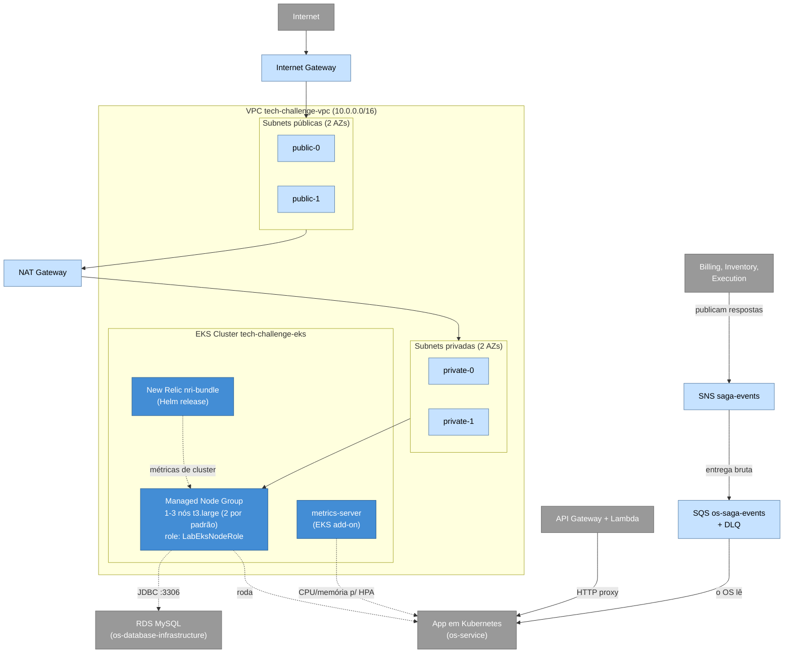

# fiap-tech-challenge-os-infrastructure

Infraestrutura de rede e cluster Kubernetes (Amazon EKS) do Tech Challenge — FIAP Pós-Tech, Arquitetura de Software, turma 15SOAT. É a infraestrutura geral do OS Service e hospeda a mensageria compartilhada da saga: provisiona, via Terraform, toda a infraestrutura de nuvem necessária para rodar a [aplicação principal](https://github.com/Adriana-Meyer/fiap-tech-challenge-os-service) em Kubernetes na AWS — exceto o banco de dados, que fica no [os-database-infrastructure](https://github.com/Adriana-Meyer/fiap-tech-challenge-os-database-infrastructure), e a Lambda/API Gateway, que ficam no [API Gateway + Lambda](https://github.com/Adriana-Meyer/fiap-tech-challenge-API-gateway-function-serverless).

## Tecnologias

| Camada | Tecnologia |
|---|---|
| Provisionamento | Terraform >= 1.5, providers `hashicorp/aws`, `hashicorp/kubernetes`, `hashicorp/helm` |
| Nuvem | AWS (conta acadêmica AWS Academy Learner Lab) |
| Rede | VPC própria, subnets públicas/privadas em 2 AZs, 1 NAT Gateway |
| Cluster | Amazon EKS (Managed Node Group) |
| Observabilidade de cluster | New Relic Kubernetes integration (`nri-bundle`, via Helm) |
| Métricas para o HPA | `metrics-server` (EKS-managed add-on) |
| Mensageria da saga | Amazon SNS (tópico `saga-events`) + Amazon SQS (fila `os-saga-events` e DLQ) |
| CI/CD | GitHub Actions |

## Arquitetura



**Decisões de desenho** (detalhadas nos ADRs/RFCs centralizados no repositório da App, pasta [`docs/`](https://github.com/Adriana-Meyer/fiap-tech-challenge-os-service/tree/main/docs)):
- O cluster usa o role `LabEksClusterRole` e o Node Group o `LabEksNodeRole`, ambos já existentes na conta AWS Academy (localizados por parte do nome, porque cada instância do Lab recebe um prefixo e um sufixo próprios) — o Learner Lab não permite criar roles/políticas IAM novos.
- 1 único NAT Gateway (não um por AZ) para reduzir custo, visto que trata-se de um projeto acadêmico e com orçamento limitado na AWS.
- Node Group de 1 a 3 instâncias `t3.large` (2 por padrão). O cluster roda quatro serviços Java, cada um com o agente do New Relic, mais os add-ons do cluster; em `t3.medium` (4 GiB) isso não cabe com folga. O Learner Lab tem um teto de 9 instâncias EC2 simultâneas e 32 vCPUs na conta inteira (20+ instâncias derruba a conta): três `t3.large` usam 6 vCPUs, o que deixa folga para outros usos eventuais de EC2. `t3.large` está entre os tamanhos permitidos no Lab (até `large`).
- **Mensageria da saga** (`messaging.tf`): o tópico SNS `saga-events` recebe as respostas do Billing, do Inventory e do Execution, e a fila `os-saga-events` (assinante do tópico) entrega ao OS. As filas de **comando** de cada serviço ficam no `*-infrastructure` do próprio serviço. Detalhes:
  - **Nomes fixos, sem prefixo de projeto:** os serviços usam `saga-events` e `os-saga-events` por padrão e montam o ARN do tópico a partir da conta, da região e desse nome. O output `saga_events_topic_arn` serve para conferir.
  - **Entrega bruta** (`raw_message_delivery`): o corpo da fila é o envelope da mensagem, sem o invólucro do SNS, que é o que o listener do OS espera.
  - **DLQ `os-saga-events-dlq`:** depois de `saga_max_receive_count` (3) tentativas, a mensagem vai para ela e fica 14 dias (o máximo do SQS) para ser inspecionada.
  - **Política da fila:** permite `sqs:SendMessage` somente ao serviço SNS e somente a partir deste tópico (`aws:SourceArn`). As permissões das roles dos pods não são afetadas, porque dentro da mesma conta basta uma das políticas (a da identidade ou a do recurso).
  - Criptografia em repouso com SSE gerenciado pelo SQS.
  - O mesmo desenho roda localmente em `os-service/e2e/localstack-init/01-saga-topology.sh`.
- **Permissões do cluster para SQS/SNS/DynamoDB:** os pods usam o role do nó (`LabEksNodeRole`), que o Learner Lab não deixa alterar. Se esse role não permitir SQS/SNS/DynamoDB, o plano alternativo é fornecer as credenciais da sessão aos pods por um Secret. Isso é verificado na validação no Lab.
- VPC e subnets recebem tags fixas (`Name`, `Tier=public/private`) e o cluster tem um nome fixo (`tech-challenge-eks`) para o os-database-infrastructure conseguir localizar a rede e o security group do cluster via `data source` do Terraform, sem precisar copiar valores manualmente entre repositórios.
- A integração do New Relic com o Kubernetes (`nri-bundle`) fica neste repositório por ser infraestrutura de cluster, não da aplicação — o `helm_release` só é criado quando a variável `new_relic_license_key` é definida (evita quebrar o `apply` antes da etapa de observabilidade).
- `metrics-server` instalado como add-on gerenciado do EKS (`aws_eks_addon`), não Helm — a AWS já oferece nativamente, sem exigir role IAM própria (diferente do New Relic, que precisa de um chart de terceiros). Sem ele, o `HorizontalPodAutoscaler` do os-service fica sem métrica de CPU/memória pra decidir quando escalar.

## Pré-requisitos

- Terraform >= 1.5
- Conta AWS Academy Learner Lab **ativa** (sessão de 4h) com credenciais temporárias exportadas
- AWS CLI e `kubectl` (para validar o cluster depois de provisionado)

## Executando

```bash
export AWS_ACCESS_KEY_ID=...
export AWS_SECRET_ACCESS_KEY=...
export AWS_SESSION_TOKEN=...

terraform init
terraform plan
terraform apply

# Configurar o kubectl para apontar para o cluster recém-criado
$(terraform output -raw kubeconfig_command)
kubectl get nodes
```

Para desativar tudo ao final da sessão do Lab (economiza orçamento do Lab):

```bash
terraform destroy
```

## CI/CD

- **`terraform-validate.yml`** — roda em todo push/PR para `develop`/`main`: `terraform fmt -check`, `terraform init -backend=false`, `terraform validate`. Não precisa de credenciais AWS.
- **`terraform-apply.yml`** — disparo manual (`workflow_dispatch`), com escolha entre `plan`/`apply`/`destroy`. Usa credenciais temporárias da sessão AWS Academy, fornecidas via GitHub Secrets (`AWS_ACCESS_KEY_ID`, `AWS_SECRET_ACCESS_KEY`, `AWS_SESSION_TOKEN`) — precisam ser atualizadas a cada nova sessão do Lab (expiram em ~4h). Fica `workflow_dispatch` manual permanentemente, inclusive no estado final entregue: essa é a alternativa adotada para economizar os recursos limitados do Lab (sessão de ~4h) — o deploy em si é automático de ponta a ponta assim que disparado, sem nenhuma intervenção manual durante a execução; só o gatilho é manual, para ser acionado quando for conveniente e a sessão do Lab estiver ativa.

## Variáveis Terraform

Todas têm valor padrão (ver [`variables.tf`](variables.tf)); a única que normalmente precisa ser definida é:

| Variável | Descrição |
|---|---|
| `new_relic_license_key` | License key de ingestão do New Relic — enquanto vazia, a integração de Kubernetes (`nri-bundle`) não é criada |
| `node_instance_type`, `node_desired_size`, `node_min_size`, `node_max_size` | Nós do cluster (padrão: `t3.large`, 2 desejados, de 1 a 3) |
| `saga_max_receive_count` | Tentativas de entrega antes de a mensagem ir para a DLQ (padrão 3) |
| `queue_visibility_timeout_seconds` | Quanto tempo uma mensagem em tratamento fica oculta para outros consumidores (padrão 30 s) |

## APIs

Este repositório não expõe API própria — é infraestrutura de plataforma. A documentação Swagger da aplicação está no [os-service](https://github.com/Adriana-Meyer/fiap-tech-challenge-os-service#documenta%C3%A7%C3%A3o-da-api-swagger-ui).
